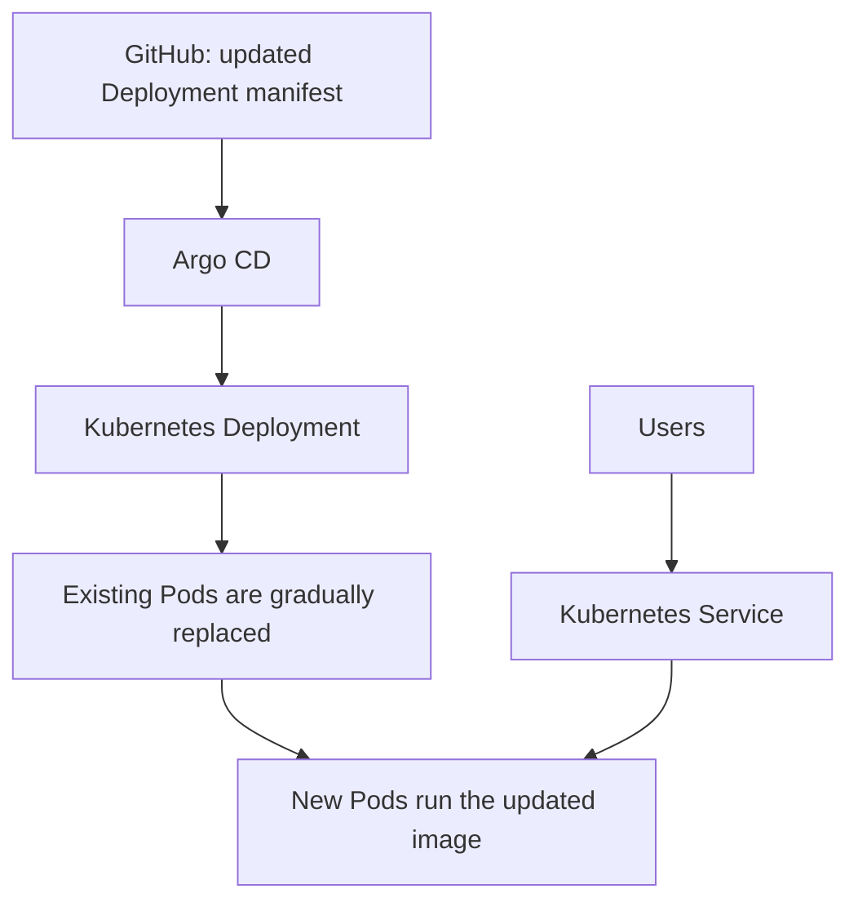
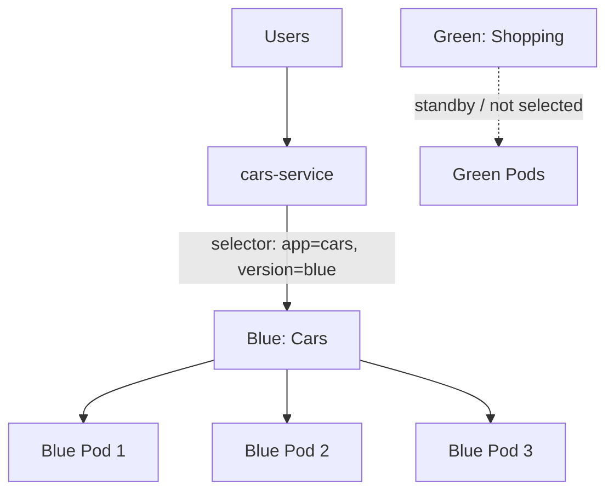
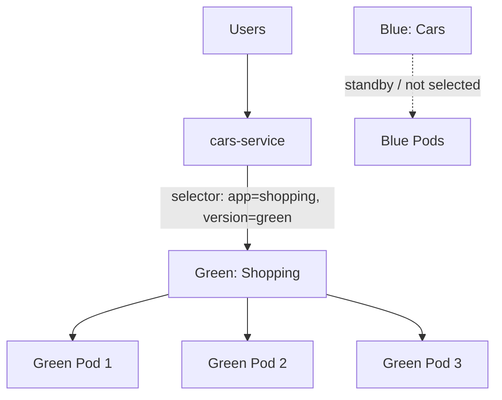
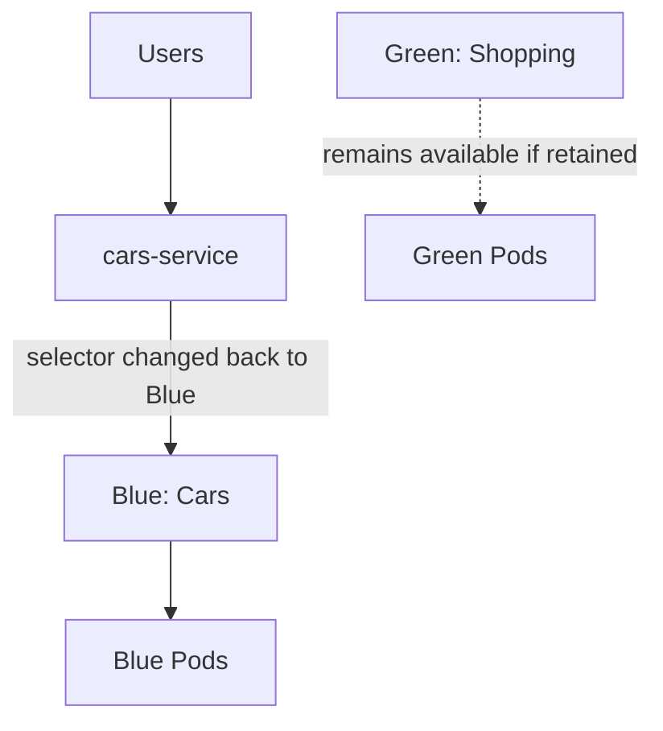
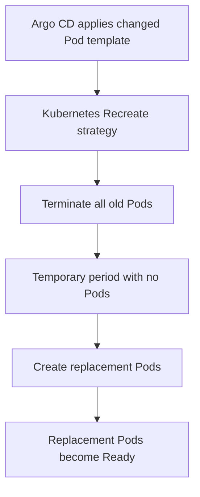
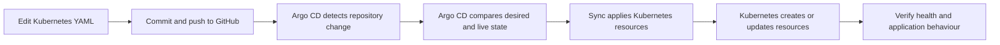

# Kubernetes Deployment Strategies with Argo CD

A hands-on project demonstrating Kubernetes deployment strategies and GitOps delivery using AWS, kOps, Kubernetes, GitHub, and Argo CD.

> **Project scope:** This repository records a learning implementation. It demonstrates the mechanics of deployment updates, service-based traffic switching, and rollback. It is not presented as a complete production platform.

## Project overview

The project uses a Kubernetes cluster provisioned with kOps on AWS. Kubernetes manifests are stored in GitHub, and an Argo CD Application watches the repository and reconciles the cluster with the declared manifests.

### Technology stack

| Technology | Use in this project |
|---|---|
| AWS EC2 | Compute infrastructure for the Kubernetes environment |
| kOps | Kubernetes cluster provisioning and management |
| Kubernetes | Deployments, Pods, Services, ConfigMaps and ResourceQuotas |
| Docker Hub | Container image registry |
| GitHub | Version-controlled Kubernetes manifests |
| Argo CD | GitOps-based application synchronisation and health visibility |

## Deployment strategies implemented

### 1. Rolling Update

**What it demonstrates:** Kubernetes gradually replaces Pods from the old application version with Pods from the updated version, according to the Deployment's rolling-update settings.

**How it was practised:**
1. Deployed the Cars application with three replicas.
2. Changed the container image in the Deployment manifest to `satishpolaka/shopping:v1`.
3. Committed the manifest change to GitHub.
4. Argo CD detected the Git change and synchronised it to Kubernetes.
5. Observed the Deployment and Pods in Argo CD.

**Example strategy configuration:**

```yaml
strategy:
  type: RollingUpdate
  rollingUpdate:
    maxSurge: 1
    maxUnavailable: 0
```

**Architecture:**



The exact rollout sequence depends on the configured replica count, surge/unavailable settings, readiness, and available cluster resources.

### 2. Blue-Green deployment and traffic switching

**What it demonstrates:** Two separate environments are kept available. A Kubernetes Service selector determines which environment receives traffic.

**How it was practised:**
1. Created a Blue Deployment using `satishpolaka/cars:v1`.
2. Created a Green Deployment using `satishpolaka/shopping:v1`.
3. Ran three replicas in each Deployment.
4. Configured the Service selector to target Blue initially.
5. Changed the Service selector to target Green.
6. Used the same Service entry point to direct traffic to the selected Pods.

**Initial state — Blue receives traffic:**



**After switching — Green receives traffic:**



**Important production distinction:** In a production Blue-Green release, Blue and Green are normally two versions of the *same application* (for example, Shopping v1 and Shopping v2). Cars and Shopping were used here as visibly different applications to make the Service selector switch easy to understand. This is a learning demonstration, not an interchangeable production release.

### 3. Rollback using the Service selector

**What it demonstrates:** If the newly selected environment has a problem, the Service selector can be changed back to the previous environment, provided that environment is still running and healthy.

**How it was practised:**
1. Switched the Service selector from Blue to Green.
2. Changed the selector back to Blue to demonstrate rollback.
3. Argo CD synchronised the updated Service manifest.

**Rollback flow:**



Rollback is a traffic switch in this exercise. It does not automatically undo database changes, external side effects, or incompatible data migrations.

### 4. Recreate deployment

**What it demonstrates:** When the Pod template of a Deployment using `strategy: Recreate` changes, Kubernetes terminates the existing Pods before creating the replacement Pods. This can cause downtime.

**How it was practised:**
1. Used a Deployment with `strategy: Recreate`.
2. Kept the existing Deployment identity and selector stable.
3. Changed the container image from `satishpolaka/cars:v1` to `satishpolaka/shopping:v1`.
4. Committed the change to GitHub.
5. Argo CD synchronised the manifest.
6. Observed the old Pods terminate before replacement Pods were created.

**Example strategy configuration:**

```yaml
strategy:
  type: Recreate
```

**Architecture:**



**Important:** Recreate applies to replacement of Pods within the same Deployment when its Pod template changes. Renaming a Deployment creates a different Kubernetes object; deleting the old Deployment through Argo CD pruning is not itself a demonstration of the Recreate strategy.

## GitOps workflow



1. Store Kubernetes manifests in the configured GitHub repository.
2. Configure the Argo CD Application with the correct repository URL, branch (for example, `main`) and manifest path.
3. Commit and push manifest changes.
4. Argo CD refreshes the repository and detects differences.
5. Synchronise the application (automatically when Auto-Sync is enabled, or manually otherwise).
6. Review Sync Status, Health Status, resource tree and Pod details in Argo CD.

## Repository layout

The active manifest set for the final Recreate exercise can be organised as:

```text
.
├── README.md
├── namespace.yml
├── configmap.yml
├── deployment-recreate.yml
├── service.yml
├── resourcequota.yml
└── screenshots/
```

Keep old manifests as backups only if they are not included in the Argo CD source path as active Kubernetes manifests. For example, use a separate `backup/` directory or file extensions such as `.bak`. Confirm Argo CD is not rendering those backup files.

## Argo CD screenshots

Add your **real screenshots from your own Argo CD UI** to the `screenshots/` directory. Do not use illustrative diagrams as proof of a successful deployment.

Suggested screenshots:

| Filename | Capture when | What it should show |
|---|---|---|
| `01-argocd-rolling-update.png` | Rolling Update is complete | Argo CD app resource tree and the updated Deployment/Pods |
| `02-argocd-blue-green-both.png` | Both environments are deployed | Blue and Green Deployments and their Pods |
| `03-argocd-blue-active.png` | Service selects Blue | Service selector or endpoint details showing Blue |
| `04-argocd-green-active.png` | Service selects Green | Service selector or endpoint details showing Green |
| `05-argocd-rollback-blue.png` | Rollback is complete | Service again selects Blue |
| `06-argocd-recreate-shopping.png` | Recreate is complete | Recreate Deployment and replacement Shopping Pods |

When capturing screenshots:
- Show the Argo CD Application name and Sync/Health status where possible.
- Expand the relevant resource tree.
- Open the Service details for traffic-switch screenshots.
- Open Deployment details to show the image and strategy.
- Avoid including credentials, tokens, private keys, or other sensitive information.

If a screenshot is not yet captured, leave the corresponding image out until you have a genuine screenshot. Example Markdown for adding it later:

```markdown

```

## Production considerations

The project demonstrates core concepts, but a production implementation should additionally consider:

- Automated build, test, image scan and release workflows.
- Immutable image tags or image digests rather than relying on mutable tags.
- Readiness, liveness and startup probes that match the real application.
- Resource requests and limits based on measured workload requirements.
- Monitoring, logs, alerts and post-deployment verification.
- Controlled promotion and rollback procedures.
- Database and API backward compatibility during releases.
- Access control, secret management and policy enforcement.
- For production Blue-Green or Canary traffic management, consider an appropriate ingress, load balancer, service mesh or progressive-delivery controller.

## Key learnings

- How Kubernetes Deployments manage application Pods.
- The difference between RollingUpdate and Recreate strategies.
- How two environments can be maintained for a Blue-Green exercise.
- How Kubernetes Service selectors direct traffic to matching Pods.
- How changing a Service selector can demonstrate traffic switching and rollback.
- How Argo CD uses Git as the desired source of truth.
- How to observe Kubernetes resources and application health in the Argo CD UI.

## Conclusion

This project gave me hands-on practice with Kubernetes deployment strategies and GitOps using Argo CD. I created and updated Kubernetes manifests, committed changes to GitHub, synchronised them through Argo CD, and observed how Deployments and Services behave during application updates, traffic switching and rollback.

The project is a foundation that can be extended with CI/CD automation, progressive delivery, monitoring, security scanning and production release controls.
